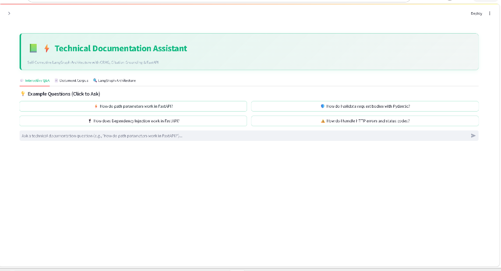
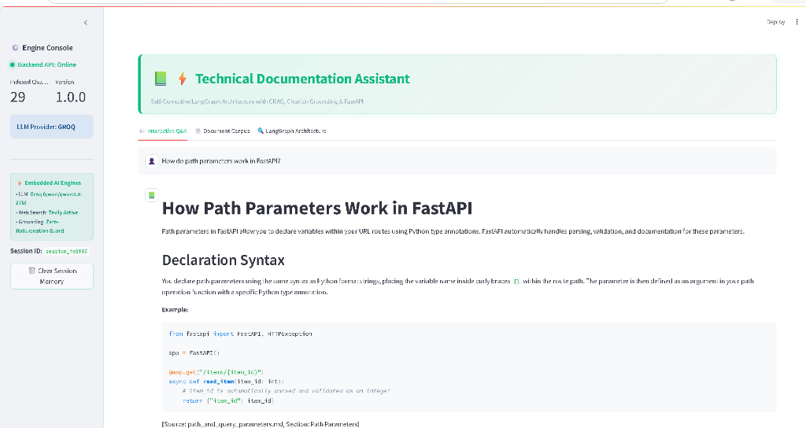
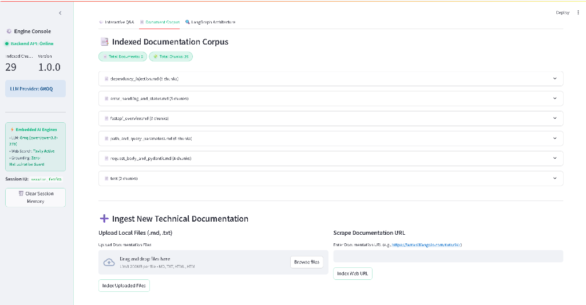

# 📚 RAG-Based Technical Documentation Assistant
### *Self-Corrective LangGraph Architecture with CRAG, Grounded Citations & FastAPI Serving*

[](https://www.python.org/)
[](https://fastapi.tiangolo.com/)
[](https://langchain-ai.github.io/langgraph/)
[](https://roshani-005-rag-technical-doc-assistant-frontend-urymnt.streamlit.app)
[](LICENSE)

---

## 🌟 Project Overview

This project is an **Agentic Technical Documentation Assistant** designed to answer software engineering questions grounded strictly in technical documentation (API references, guides, and architectural manuals).

Traditional naive RAG architectures suffer from two fatal flaws:
1. **Context Pollution:** Retrieving chunks that contain similar keywords but lack actual answers, confusing the generator.
2. **Silent Hallucinations:** Generative models fabricating APIs, function parameters, or incorrect code when retrieved context is incomplete.

To eliminate these issues, this system implements a **Self-Corrective LangGraph Workflow** inspired by **Corrective RAG (CRAG)** and **Self-RAG**:
- **Intent Analysis & Query Expansion:** Classifies question intent (`how-to`, `conceptual`, `troubleshooting`, `api-reference`) and reformulates queries with technical synonyms.
- **Document Grading (Self-Correction):** An LLM evaluates each retrieved chunk for factual relevance, pruning irrelevant documents before generation.
- **Dynamic Retry Loop:** If all retrieved chunks are irrelevant, the system reformulates search queries and re-searches the vector store (up to a bounded retry limit).
- **Web Search Fallback:** When local documents cannot answer the question after max retries, the assistant falls back to external web search (Tavily / DuckDuckGo) or explicitly declines rather than hallucinating.
- **Citation Grounding:** Every factual statement references its exact source file and section.
- **Hallucination Verification (Self-RAG):** Answers undergo an automated groundedness check against retrieved context.
- **Full API & UI:** Served via an asynchronous **FastAPI** backend with an interactive **Streamlit** user interface and evaluation feedback logging.

---

## 🖥️ Live Demo & User Interface

### 1. Interactive Q&A Landing Page
Clean Technical Green interface featuring quick-start question starters and real-time backend/engine status.


### 2. Zero-Hallucination Answers & Verified Citations
Factual answers generated strictly from retrieved documentation context, complete with explicit section citations and code snippets.


### 3. Document Corpus & Dynamic Ingestion
Inspect currently indexed vector chunks and upload new Markdown files or scrape web documentation on the fly.


---

## 🏗️ System Architecture

### LangGraph State Machine

```
                        ┌────────────────────────┐
                        │   User Raw Question    │
                        └───────────┬────────────┘
                                    │
                                    ▼
                        ┌────────────────────────┐
                        │  Node 1: Query Analysis│
                        │  - Intent Classifier   │
                        │  - Query Expansion     │
                        └───────────┬────────────┘
                                    │
                                    ▼
                        ┌────────────────────────┐
                        │   Node 2: Retrieval    │◄─────────────────┐
                        │   (ChromaDB top-k)     │                  │
                        └───────────┬────────────┘                  │
                                    │                               │
                                    ▼                               │ (Rewrite Query)
                        ┌────────────────────────┐                  │
                        │Node 3: Document Grading│                  │
                        │ (Filter Irrelevant)    │                  │
                        └───────────┬────────────┘                  │
                                    │                               │
                       Is any chunk relevant?                       │
                      /                      \                      │
              YES    /                        \   NO                │
                    /                          \                    │
                   ▼                            ▼                   │
                  │                      Retries < Limit?           │
                  │                     /                \          │
                  │                    / YES              \ NO      │
                  │                   ▼                    ▼        │
                  │            ┌───────────────┐   ┌──────────────┐ │
                  │            │Query Rewriter │   │ Web Fallback │ │
                  │            │(Reformulate)  │   │(Tavily / DDG)│ └───┘
                  │            └───────────────┘   └──────┬───────┘
                  │                                       │
                  ▼                                       ▼
      ┌────────────────────────────────────────────────────────┐
      │                   Node 4: Generation                   │
      │    - Context Synthesis (Local Docs or Web Fallback)    │
      │    - Strict Inline Citations                           │
      └───────────────────────────┬────────────────────────────┘
                                  │
                                  ▼
      ┌────────────────────────────────────────────────────────┐
      │         Node 5: Hallucination Verification             │
      │         - Automated Self-RAG Groundedness Check        │
      │         - Regulates regeneration if ungrounded         │
      └───────────────────────────┬────────────────────────────┘
                                  │
                                  ▼
                             Final Answer
                        (Verified with Citations)
```

### State Schema (`GraphState`)

The LangGraph `StateGraph` enforces strict typing and flow control between nodes:

```python
class GraphState(TypedDict):
    question: str                      # Original raw user input
    query_type: str                    # conceptual | how-to | troubleshooting | api-reference
    transformed_query: str             # Enriched/expanded query for retrieval
    documents: List[Document]          # Raw retrieved chunks from ChromaDB
    filtered_docs: List[Document]      # Chunks confirmed relevant by LLM Grader
    generation: str                    # Final synthesized answer
    citations: List[Dict[str, Any]]    # Extracted source citations
    retry_count: int                   # Current rewrite retry count (prevents infinite cycles)
    max_retries: int                   # Configurable max retries threshold (default: 2)
    is_fallback: bool                  # True if answered via web search or fallback
    is_grounded: bool                  # True if verified against hallucinations
    chat_history: List[Dict[str, str]] # Multi-turn session memory
```

---

## 📂 Project Directory Structure

```text
rag-doc-assistant/
├── app/
│   ├── __init__.py
│   ├── config.py             # Pydantic environment configuration
│   ├── main.py               # FastAPI application & REST endpoints
│   ├── models/
│   │   ├── __init__.py
│   │   └── schemas.py        # Pydantic V2 Request & Response schemas
│   ├── services/
│   │   ├── __init__.py
│   │   ├── llm_factory.py    # Multi-provider LLM factory (Groq, Gemini, OpenAI, Mock)
│   │   ├── vectorstore.py    # Persistent ChromaDB client & embeddings
│   │   ├── ingestion.py      # Markdown-aware chunker & URL scraper
│   │   └── search.py         # Tavily / DuckDuckGo fallback search
│   └── graph/
│       ├── __init__.py
│       ├── state.py          # LangGraph GraphState TypedDict
│       ├── nodes.py          # Graph nodes (Analysis, Retrieval, Grading, Rewriting, Generation)
│       ├── edges.py          # Conditional routing logic
│       └── workflow.py       # Compiled StateGraph with MemorySaver checkpointer
├── data/
│   ├── docs/                 # Included technical documentation corpus (FastAPI Guides)
│   │   ├── fastapi_overview.md
│   │   ├── path_and_query_parameters.md
│   │   ├── request_body_and_pydantic.md
│   │   ├── dependency_injection.md
│   │   └── error_handling_and_status.md
│   ├── chroma_db/            # Persistent vector database directory
│   └── feedback.json         # Evaluation logging store
├── tests/
│   ├── __init__.py
│   ├── test_graph.py         # LangGraph state transitions and edge routing tests
│   └── test_api.py           # FastAPI endpoints integration tests
├── .env.example              # Sample environment file
├── Dockerfile                # Production container specification
├── docker-compose.yml        # Multi-container Compose orchestration
├── frontend.py               # Streamlit interactive dashboard
├── ingest.py                 # Standalone ingestion CLI runner
├── requirements.txt          # Pinned dependency requirements
└── README.md                 # Complete technical documentation
```

---

## 🚀 Quickstart Guide

### 1. Prerequisites
- Python 3.10, 3.11, or 3.12
- An API Key from **Groq** (Recommended for free, ultra-fast inference) OR **Google Gemini** OR **OpenAI**.

### 2. Clone and Setup Environment
```bash
# Clone the repository
git clone https://github.com/your-username/rag-doc-assistant.git
cd rag-doc-assistant

# Create virtual environment
python -m venv venv

# Activate virtual environment
# Windows (PowerShell):
.\venv\Scripts\Activate.ps1
# Linux / macOS:
source venv/bin/activate

# Install dependencies
pip install -r requirements.txt
```

### 3. Configure API Keys
Copy `.env.example` to `.env`:
```bash
cp .env.example .env
```
Open `.env` and set your preferred provider:
```ini
LLM_PROVIDER=groq
GROQ_API_KEY=gsk_your_groq_api_key_here
# Optional: TAVILY_API_KEY=tvly_your_tavily_key
```
*(Note: If no API key is set, the application automatically activates `MockChatModel` so all endpoints and tests run offline seamlessly!)*

### 4. Ingest Technical Documentation
Run the standalone ingestion CLI to index the bundled documentation corpus into ChromaDB:
```bash
python ingest.py
```
To verify indexed chunks:
```bash
python ingest.py --stats
```

### 5. Start the Application

#### Option A: Run FastAPI Server (Backend)
```bash
uvicorn app.main:app --host 0.0.0.0 --port 8000 --reload
```
Interactive API docs are available at:
- **Swagger UI:** [http://localhost:8000/docs](http://localhost:8000/docs)
- **ReDoc:** [http://localhost:8000/redoc](http://localhost:8000/redoc)

#### Option B: Run Interactive Streamlit UI (Frontend)
In a separate terminal window:
```bash
streamlit run frontend.py
```
Open your browser at [http://localhost:8501](http://localhost:8501) for the interactive Q&A interface!

#### Option C: Run via Docker Compose
```bash
docker-compose up --build
```

---

## 📡 API Endpoints & Example Requests

### 1. `POST /query` – Ask a Technical Question
**Request:**
```bash
curl -X POST "http://localhost:8000/query" \
     -H "Content-Type: application/json" \
     -d '{
       "question": "How do I declare optional query parameters with default values in FastAPI?",
       "thread_id": "session-101"
     }'
```

**Response:**
```json
{
  "query_id": "q_7f8a9b1c",
  "question": "How do I declare optional query parameters with default values in FastAPI?",
  "query_type": "how-to",
  "answer": "In FastAPI, function parameters that are not part of the route path are automatically interpreted as query parameters. You can make them optional by providing a default value or typing them as Optional/str | None.\n\n```python\nfrom typing import Optional\nfrom fastapi import FastAPI\n\napp = FastAPI()\n\n@app.get(\"/items/\")\nasync def read_items(skip: int = 0, limit: int = 10, search: Optional[str] = None):\n    return {\"skip\": skip, \"limit\": limit, \"search\": search}\n```\n\n- When a client calls `/items/`, `skip` defaults to 0 and `limit` defaults to 10.\n- `search` is optional and defaults to `None`.\n\nCitations:\n- [Source: path_and_query_parameters.md | Section: Query Parameters]",
  "sources": [
    {
      "source": "path_and_query_parameters.md",
      "section": "Path Parameters and Query Parameters > Query Parameters",
      "snippet": "Function parameters that are not part of the path parameters are automatically interpreted as 'query parameters':\n\n```python\nfrom typing import Optional\n\n@app.get('/items/')\nasync def read_items(skip: int = 0..."
    }
  ],
  "retries_used": 0,
  "is_fallback": false,
  "is_grounded": true,
  "thread_id": "session-101"
}
```

### 2. `POST /ingest` – Upload New Documentation Files
**Request:**
```bash
curl -X POST "http://localhost:8000/ingest" \
     -F "files=@./data/docs/fastapi_overview.md"
```

**Response:**
```json
{
  "status": "success",
  "message": "Successfully indexed 1 files into 4 vector chunks.",
  "indexed_documents": ["fastapi_overview.md"],
  "total_chunks_added": 4
}
```

### 3. `POST /ingest/urls` – Scrape and Index Web Documentation
**Request:**
```bash
curl -X POST "http://localhost:8000/ingest/urls" \
     -H "Content-Type: application/json" \
     -d '{
       "urls": ["https://fastapi.tiangolo.com/tutorial/first-steps/"]
     }'
```

### 4. `GET /documents` – Inspect Current Corpus
**Request:**
```bash
curl -X GET "http://localhost:8000/documents"
```

**Response:**
```json
{
  "total_documents": 5,
  "total_chunks": 21,
  "documents": [
    {
      "source": "fastapi_overview.md",
      "chunk_count": 4,
      "sections": ["FastAPI Overview and Core Concepts", "Key Features", "Asynchronous Code with ASGI"]
    },
    {
      "source": "path_and_query_parameters.md",
      "chunk_count": 5,
      "sections": ["Path Parameters", "Query Parameters", "Validation with Annotated and Query"]
    }
  ]
}
```

### 5. `POST /feedback` – Answer Quality Rating
**Request:**
```bash
curl -X POST "http://localhost:8000/feedback" \
     -H "Content-Type: application/json" \
     -d '{
       "query_id": "q-101",
       "rating": "up",
       "comment": "Accurate code sample and correct explanation of query parameters.",
       "question": "How do I declare optional query parameters?"
     }'
```

---

## 🧪 Running Automated Tests

Run the test suite with `pytest`:
```bash
pytest -v
```

Tests cover:
- StateGraph conditional routing edges (`decide_after_grading`)
- Retry increment logic and cycle termination
- Query classification and keyword expansion
- FastAPI endpoints (`/`, `/health`, `/documents`, `/feedback`, `/query`)
- Error handling on blank queries and malformed inputs

---

## 🧠 Design Decisions & Trade-Offs

### 1. Two-Stage Markdown-Aware Chunking vs. Fixed-Size Chunking
* **The Problem:** Technical documentation relies heavily on Markdown headers (`#`, `##`, `###`) and fenced code blocks (` ```python `). Naive character chunking splits code blocks in half, resulting in invalid code and context loss.
* **Our Solution:** We use `MarkdownHeaderTextSplitter` as the primary structural boundary, preserving the section hierarchy in metadata (e.g. `section: Path Parameters > Query Parameter Validation`). We then apply `RecursiveCharacterTextSplitter` with separators `["\n```", "```\n", "\n\n", "\n", " "]`.
* **Trade-off:** Markdown parsing requires well-structured source text. For plain text and raw HTML, we gracefully fall back to sentence-boundary recursive splitting.

### 2. Self-Corrective CRAG Routing vs. Linear RAG
* **The Problem:** Standard RAG always generates an answer, even when the retrieved context is completely irrelevant. This results in subtle, dangerous hallucinations.
* **Our Solution:** A dedicated **Document Grading Node** scores each chunk individually. If 0 relevant chunks are found, the graph does not give up immediately; it activates the **Query Rewriter Node** to reformulate search terms and queries the vector store again.
* **Cycle Prevention:** To prevent infinite loops and runaway API costs, the state tracks `retry_count`. Once `retry_count >= max_retries`, the edge unconditionally routes to the **Fallback Path** (Web Search or explicit admission of lack of information).

### 3. Embeddings: HuggingFace Local vs. OpenAI API
* **Choice:** We default to `sentence-transformers/all-MiniLM-L6-v2`.
* **Rationale:** It runs locally on CPU with zero network latency, zero costs, and zero rate-limiting. For teams with dedicated OpenAI quotas, switching to `text-embedding-3-small` is a simple one-line `.env` change (`EMBEDDING_PROVIDER=openai`).

### 4. Hallucination Mitigation (Self-RAG Groundedness Check)
* **Design:** Before returning the final response, an LLM groundedness evaluator verifies whether every factual claim in the generated answer is directly backed by the retrieved text. If unsupported claims are detected, the response is flagged (`is_grounded=False`) and guarded against misleading the user.

---

## 🔮 What I Would Improve With More Time

1. **Hybrid Search (Dense + Sparse BM25):**
   Combine vector similarity search with BM25 keyword matching via Reciprocal Rank Fusion (RRF). Technical documentation frequently involves exact variable names and method signatures (e.g., `status_code=422`) where BM25 outperforms purely dense semantic vectors.
2. **Cross-Encoder Re-Ranking:**
   Integrate a cross-encoder model (e.g., `bge-reranker-large` or Cohere Rerank) between retrieval and grading to rank the top 20 candidate chunks down to the top 4 highest-precision chunks.
3. **Automated Evaluation Benchmarking (Ragas / TruLens):**
   Set up continuous offline evaluation measuring **Context Precision**, **Context Recall**, and **Faithfulness** across a golden dataset of technical question-answer pairs.
4. **Persistent Multi-User Memory:**
   Replace the in-memory `MemorySaver` with a persistent PostgreSQL or Redis checkpointer to scale state storage across distributed workers.

---

## 📋 System Assumptions

During the architectural design and implementation of this assistant, the following assumptions were made:

1. **Document Ingestion Formats & Structure:**
   - The primary input format is Markdown (`.md`), which allows header-aware chunking (`#`, `##`, `###`) to preserve semantic section boundaries and code block integrity. Plain text (`.txt`) and HTML (`.html`) files are supported, with HTML stripped of markup tags and scripts via BeautifulSoup before chunking.
2. **Deterministic & Idempotent Ingestion:**
   - Document chunk IDs are generated deterministically using SHA-256 hashes of `f"{source_name}:{content.strip()}"`. Re-ingesting or updating documentation updates existing chunks in place rather than generating duplicate vectors.
3. **Session & Memory Persistence:**
   - Conversational memory is tracked per session using LangGraph's `MemorySaver` checkpointer keyed by `thread_id`. In a multi-instance production cluster, this can be swapped with `PostgresSaver` or Redis without changing node logic.
4. **Deterministic Testing & Offline Execution:**
   - When external LLM API keys are absent or during CI testing (`pytest`), the system automatically switches to `LLM_PROVIDER=mock`. This ensures all pipeline branches, retry loops, and API contracts can be verified reliably offline without external rate limits or network dependencies.
5. **Bounded Self-Correction:**
   - The retry loop is capped at `MAX_RETRIES=2` to ensure responsive SLA times and avoid circular search loops. If local documents do not satisfy the query, the assistant transitions to external search fallback.

---

## 👨‍💻 Author & Submission Notes

- **Role:** AI/ML Engineer - Intern Candidate
- **Organization:** Express Analytics
- **Stack:** Python 3.11, LangGraph, FastAPI, ChromaDB, Streamlit, Groq/OpenAI.
